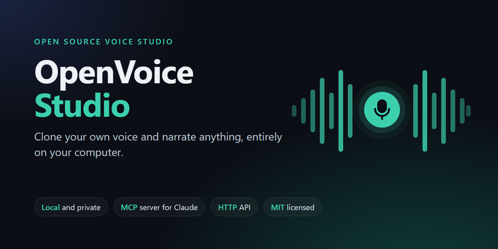

# OpenVoice Studio



Local-first, open-source voice cloning & narration engine with a web UI, an HTTP API and an MCP server.
Record or upload 1–3 minutes of your own voice, then generate narration with it from the browser,
the command line, or Claude (via MCP). Everything runs on your computer. No audio leaves it, and it costs 0 €.

> Portuguese quick start: see [COMECAR_AQUI.md](COMECAR_AQUI.md).
> Installing with an AI coding agent: see [INSTALL_WITH_AI.md](INSTALL_WITH_AI.md).
>
> Not affiliated with MyShell's "OpenVoice" model. This project ships its own engine adapters.

## Features

- **Voice creation with guard rails**: upload WAV/MP3/M4A or record in the browser while reading a guided script. A recording check reports speech time, level, noise (SNR) and clipping, and gives guidance in plain language. A voice is only created after an explicit consent statement, which is stored with it.
- **Narration**: Portuguese-aware text preparation (numbers, € / Kz / %), sentence chunking with style-controlled pauses, automatic retry of garbled takes, and loudness normalisation to -18 LUFS. Four styles: `documental`, `natural`, `didactico`, `energetico`.
- **Evaluation**: speaker similarity (the engine's speaker encoder, reference vs. output), intelligibility (local faster-whisper transcription → WER/CER), pace, loudness and pauses, plus warnings.
- **Progress you can follow**: every job reports a percentage, the current stage and the time left. Within each sentence the engine counts real speech tokens and diffusion steps, and time left is calibrated on this machine's measured speed.
- **One model in memory**: the web UI, the API and every MCP client share one local server and one job queue.
- **Engine**: [Chatterbox Multilingual](https://github.com/resemble-ai/chatterbox) by Resemble AI. It is MIT-licensed (code and weights), supports 23 languages including Portuguese, and runs on CPU, CUDA or Apple MPS. Its outputs carry Resemble's imperceptible PerTh watermark.

## Install

Requirements: about 6 GB of free disk space, 8 GB of RAM (16 GB recommended), `ffmpeg`, and an internet connection for the first model download (~3.2 GB).

```bash
# macOS / Linux
curl -LsSf https://raw.githubusercontent.com/Dalcio/openvoice-studio/main/install.sh | sh
```

```powershell
# Windows (PowerShell)
powershell -ExecutionPolicy ByPass -c "irm https://raw.githubusercontent.com/Dalcio/openvoice-studio/main/install.ps1 | iex"
```

From a checkout: `OVS_SOURCE=. sh install.sh` or `$env:OVS_SOURCE="."; powershell -ExecutionPolicy ByPass -File .\install.ps1`.

The installer uses [uv](https://docs.astral.sh/uv/) to install the CLI into an isolated Python 3.11 environment. It then runs `openvoice-studio setup --yes`, which downloads the models and registers the MCP server with Claude Code (user scope) and Claude Desktop, after backing up their config files. Finally it runs `openvoice-studio doctor`.

## Use

```bash
openvoice-studio ui            # opens http://127.0.0.1:8765/#token=… in your browser
openvoice-studio voices        # list voices and their voice_id
openvoice-studio voices --rebuild <voice_id>   # redo the cloning reference from the stored takes
openvoice-studio generate --voice <voice_id> --text "Olá!" --style documental --out ola.wav
openvoice-studio doctor        # environment check (JSON, "ok": true|false)
openvoice-studio selftest      # end-to-end pipeline test without models (JSON)
openvoice-studio setup --yes --evaluation   # also download the evaluation model (faster-whisper small)
```

On a laptop CPU (tested on an i7-1165G7), expect roughly 5–10 seconds of compute per second of audio. A CUDA GPU is much faster.

### MCP tools (Claude)

| Tool | What it does |
| --- | --- |
| `get_engine_capabilities` | Engines, languages, styles, limits, and model/evaluation status |
| `list_voices` | Voices created in the UI (`voice_id`, quality, status) |
| `generate_narration(text, voice_id, style, language, wait_seconds)` | Generates a WAV and waits up to `wait_seconds` |
| `get_job_status(job_id, wait_seconds)` | Polls a long job |
| `get_audio_artifact(job_id, destination_dir?, filename?)` | Copies the WAV to the Desktop (default) or a folder |
| `run_voice_evaluation(job_id, wait_seconds)` | Similarity, WER/CER, pace, loudness, warnings |

The MCP server is a thin client of the local HTTP server and starts it on demand. MCP tools appear only in **new** Claude sessions after `setup`.

### HTTP API

The API listens on `127.0.0.1:8765` only. Requests must carry the token from `<data dir>/token` as `Authorization: Bearer <token>`. Endpoints: `GET /api/health`, `GET /api/capabilities`, `GET|POST /api/voices`, `POST /api/voices/check`, `DELETE /api/voices/{id}`, `POST /api/generate`, `GET /api/jobs/{id}?wait=10`, `GET /api/audio/{job_id}.wav`, `POST /api/evaluate`. Requests addressed to any other `Host` are rejected, which blocks DNS rebinding.

The data directory is `%USERPROFILE%\.openvoice-studio`, `~/Library/Application Support/OpenVoiceStudio`, or `~/.local/share/openvoice-studio`. Override it with `OVS_HOME`.

On Windows, if you install from inside a packaged app such as Claude Desktop, Windows keeps the uv tool environment in that app's private AppData. It then works inside the app but not from a regular terminal. `doctor` warns about this. To fix it, reinstall from a normal PowerShell window.

## Responsible use

Only clone your own voice, or a voice whose owner gave you explicit, informed permission. The UI requires that statement before it creates a voice and stores it with the voice. Never use generated speech to deceive, impersonate or defraud. Outputs from the default engine are watermarked.

## Development

```bash
uv venv --python 3.11 && uv pip install -e ".[dev]"
uv run pytest
```

See [CONTRIBUTING.md](CONTRIBUTING.md) for the engine-adapter rules (licence audit first, same benchmark protocol). Third-party licences are listed in [THIRD_PARTY_NOTICES.md](THIRD_PARTY_NOTICES.md).

## Licence

MIT. See [LICENSE](LICENSE).
